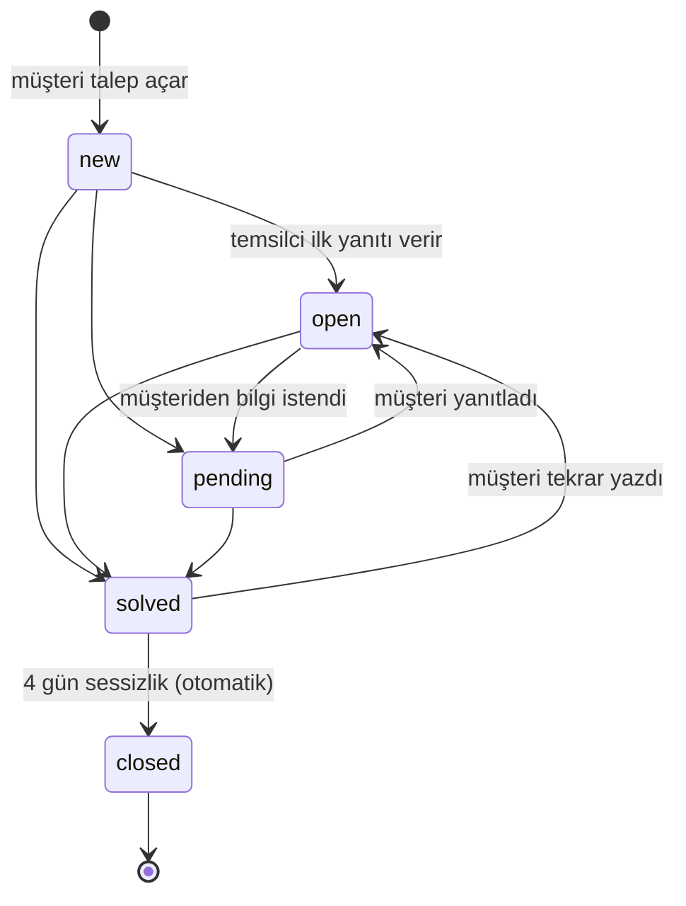

<p align="center"></p>

# Talepio: SLA radarlı destek masası

[](https://github.com/tkara55/talepio/actions/workflows/ci.yml)

- **Canlı uygulama:** _deploy sonrası eklenecek_
- **İlham kaynağı:** Zendesk Support. Uygulamada Zendesk adı ve logosu kullanılmaz; Talepio adı ve logosu bu proje için yapıldı.
- **Teknoloji:** Ruby 3.4, Rails 8.1, Hotwire (Turbo + Stimulus). Geliştirme ve testte SQLite, Render'da PostgreSQL.

> **Tek cümlelik özet:** Zendesk'te SLA uyarıları saatte bir çalışan otomasyonlara bağlı olduğu için 15 dakikalık SLA'sı olan destek ekipleri, ihlali ancak iş işten geçtikten sonra öğreniyor ([2015'ten beri açık olan topluluk talebi](https://community.zendesk.com/fid-0/tid-5392)). Talepio ise riski başladığı dakikada yakalıyor, talep atanmamışsa en boş temsilciye atıyor ve kalan süreyi saniye saniye gösteriyor.

---

## 1. Faz 1: Fortune 500 genel tablosu

| Soru | Yaklaşık değer | Kaynak |
|---|---|---|
| **a. Değerleme aralığı** | **~0,7 milyar $ → ~5,1 trilyon $.** En büyüğü NVIDIA (5,09 trilyon $, 24 Eki 2026). Küçük uçta, 2025 listesindeki A-Mark Precious Metals (~0,72 milyar $) var. Listenin toplam piyasa değeri 55 trilyon $. Not: listede halka açık olmayan şirketler de var, onların piyasa değeri yok. | [CompaniesMarketCap: NVIDIA](https://companiesmarketcap.com/nvidia/marketcap/) · [CompaniesMarketCap: A-Mark](https://companiesmarketcap.com/a-mark-precious-metals/marketcap/) · [Fortune 2026 Fortune 500 duyurusu](https://fortunemedia.mediaroom.com/2026-06-03-Amazon-Claims-No-1-Spot-on-the-Fortune-500) |
| **b. Çalışan sayısı aralığı** | **~486 → ~2,1 milyon.** En azı A-Mark (486), en çoğu Walmart (~2,1 milyon). 2026 listesinin toplamı 30,5 milyon kişi. | [Fortune: en büyük ve en küçük kadrolar (2025)](https://fortune.com/2025/06/02/fortune-500-employees-headcount-workforce-largest-smallest) · [Fortune 2026 duyurusu](https://fortunemedia.mediaroom.com/2026-06-03-Amazon-Claims-No-1-Spot-on-the-Fortune-500) |
| **c. Bir firmanın kullandığı SaaS sayısı** | **~660 uygulama** (10.000+ çalışanlı firmalarda ortalama). Kayıt dışı "gölge BT" de sayılınca 4.000+ çalışanlı firmalarda ortalama **2.191**'e çıkıyor. | [Zylo 2025 SaaS Management Index](https://zylo.com/news/2025-saas-management-index) · [Torii SaaS Benchmark 2026](https://www.toriihq.com/saas-statistics) |
| **d. SaaS'a yıllık ödenen para** | **~284 milyon $/yıl** (10.000+ çalışanlı firmalarda ortalama). Çalışan başına 4.830 $/yıl. | [Zylo 2025 SaaS Management Index](https://zylo.com/news/2025-saas-management-index) |

Fortune 500'e girme eşiği 2026'da 7,5 milyar $ gelir ([Fortune](https://fortunemedia.mediaroom.com/2026-06-03-Amazon-Claims-No-1-Spot-on-the-Fortune-500)).

## 2. SaaS seçimi ve Fortune 500 kanıtı

**Seçim: Zendesk Support.** Talep gelir, atanır, yanıtlanır ve çözülür.

- **Kanıt (Uber):** Zendesk'in kendi müşteri hikâyesine göre Uber, Zendesk'i 2010'dan beri kullanıyor. 1.000'den fazla destek temsilcisi var ve sohbet kanalında 30 saniyelik ilk yanıt SLA'sıyla çalışıyorlar: [zendesk.com/customer/uber](https://www.zendesk.com/customer/uber/). Uber, Zendesk'in 2014 halka arz belgesinde (S-1) de vaka çalışması olarak geçiyor: [SEC S-1](https://www.sec.gov/Archives/edgar/data/0001463172/000119312514137878/d665368ds1.htm).
- **Uber Fortune 500'de:** 52 milyar $ gelir, 34.000 çalışan: [Fortune: Uber Technologies](https://fortune.com/company/uber-technologies/fortune500).
- **Neden para ödüyorlar:** Büyük destek ekiplerinin sözleşmeye bağlı yanıt sürelerini (SLA) tutturması, talebin kaybolmaması ve kimin neye baktığının görünmesi için.

## 3. Faz 2: Satır sayısı ve maliyet tahmini

### Zendesk kaç satır?
Zendesk'in kodu açık değil, bu yüzden açık kaynak en yakın benzeri **Zammad**'ı (o da Rails ile yazılmış bir kurumsal yardım masası) **kendim saydım.** `git clone --depth 1` ile indirip `git grep -c ''` ile satırları saydım (commit tarihi 25 Eki 2026):

| Zammad | Satır |
|---|---|
| Uygulama kodu (`app`, `lib`, `config`, `db`; yml/json hariç) | **~737.000** |
| Testler (`spec`, `test`) | ~405.000 |
| Dile göre: Ruby 511K · TypeScript 242K · CoffeeScript 82K · Vue 80K · JS 66K | |

Zendesk Support, Zammad'dan daha fazla kanal, entegrasyon ve raporlama içeriyor. Sadece **çekirdeği** (talep, atama, SLA, tetikleyici ve otomasyonlar, görünümler, makrolar, e-posta kanalı, müşteri portalı) alırsam ödevdeki **~300.000 satır** ölçeğine denk geliyor.

### Bu çekirdeği bugünün ajanlarıyla üretmek ne tutar?
- **Gerçekte harcadığım (bu aort dilimi):** Talepio'nun **~1.200 satır uygulama kodu ve ~320 satır testi**, Claude Code (Claude Pro, [aylık 20 $](https://claude.com/pricing)) ile yaklaşık **1 saatte** yazıldı. Buna araştırma, tarayıcıda deneme ve test de dahil. Bu oturum, Pro planının 5 saatlik kotasının ~%22'sini ve haftalık kotasının ~%13'ünü kullandı. Ek ödeme yapılmadı.
- **Tahminim (çekirdeğin tamamı):** Satır başına doğrusal hesap yapılırsa 300K / 1,5K ≈ 200 iş birimi çıkıyor. Bu, Pro kotasıyla aylar sürer; Max planıyla ([100 $'dan başlıyor](https://claude.com/pricing)) ve paralel ajan oturumlarıyla **6-10 hafta** ve **abonelik olarak ~300-600 $** tahmin ediyorum. Ancak asıl maliyet token değil: entegrasyonlar, göç, güvenlik, ölçek ve **insan kontrolü**. Ajanın "yaptım" dediği her şeyi çalıştırıp doğrulamak, kodu yazdırmaktan daha uzun sürüyor.

## 4. Aort dilimi: canlıda uçtan uca çalışan akış

**Müşteri** talep açar → kuyruğa düşer → **temsilci** üstlenir, yanıtlar → beklemeye alır ya da çözer → müşteri yazarsa talep yeniden açılır → çözülmüş talep 4 gün sonra kapanır.



**Zaman kuralları**
1. **İlk yanıt SLA'sı:** Acil 15 dk, Yüksek 1 sa, Normal 4 sa, Düşük 8 sa. Hedefin son %25'i (en az 5 dk) **riskte** sayılır, süre dolunca **ihlal** olur.
2. **Otomatik kapanış:** `solved` durumundaki talep 4 gün içinde müşteriden ses gelmezse `closed` olur.

**Canlıda denemek için**
1. Ana sayfa → *Talep oluştur*. Talep açılınca müşteriye özel takip bağlantısı verilir.
2. *Temsilci girişi* → bir temsilci seç → **Kuyruk**. Liste son tarihe göre sıralı, her talepte canlı geri sayım var.
3. Talebi aç → *Gönder · Beklemede* / *Gönder · Çözüldü*. Sağ panelde durum geçişleri, atama ve SLA bilgisi var.
4. Sunumda saatlerce beklememek için kuyruğun sağında **Demo senaryoları** var. Bunlar geçmiş tarihli talep oluşturur: *11 dk önce açılmış acil talep* (riskte), *20 dk önce açılmış* (ihlal), *4 gün 1 saat önce çözülmüş* (otomatik kapanır). Kurallar değişmiyor, sadece talebin açılış anı geriye alınıyor.

## 5. Kullanılabilir pas: çözülen kullanıcı acısı

**Kimin acısı:** SLA'sı bir saatten kısa olan destek ekiplerinin (acil kuyruklar, sosyal medya kanalları, sözleşmeli müşteriler).

**Hangi yorumdan:** Zendesk topluluğundaki **"SLA Alerting in Minutes"** fikir başlığı ([community.zendesk.com/fid-0/tid-5392](https://community.zendesk.com/fid-0/tid-5392)). Eylül 2015'te açıldı, 93 oy ve 100 yanıt aldı. Açan kullanıcı (Celia12) şöyle yazıyor: *"Many of us have critical priorities of MUCH less than an hour."* Başka kullanıcılar bu sınırın yüzünden ürün değiştirmeyi düşündüklerini yazıyor. Sorunun teknik kaynağını Zendesk'in kendi belgesi doğruluyor: otomasyonlar saatte bir çalışıyor ve uyarı ihlalden bir saat önce ya da bir saat sonra gelebiliyor ([Zendesk Help Center](https://support.zendesk.com/hc/en-us/articles/4408820131994-Workflow-How-to-alert-your-team-to-tickets-nearing-an-SLA-breach)).

**Talepio'nun çözümü: SLA Radarı** ([`app/models/sla_radar.rb`](app/models/sla_radar.rb))
- Radar **dakikada bir** tarar: sunucu içindeki zamanlayıcı ([`config/initializers/sla_radar.rb`](config/initializers/sla_radar.rb)) çalışır, ayrıca temsilci her istek yaptığında ve açık kuyruk her 30 saniyede yenilendiğinde de tarama yapılır. Talep riske girdiği dakikada bir **uyarı** kaydı, son tarih geçtiği dakikada bir **ihlal** kaydı açılır. Bu kayıtlar kuyruğun "Radar olayları" panelinde görünür.
- Riskteki talep **atanmamışsa**, açık işi en az olan temsilciye **otomatik atanır.**
- Kuyrukta her talep için kalan süre **saniye saniye** sayılır. Rozet, sayfa yenilenmeden "Süre var", "Riskte" ve "İhlal" arasında geçer.
- 15 dakikalık bir SLA'da uyarının 10. dakikada, ihlalin 15. dakikada kaydedildiği **testle** kanıtlanıyor ([`test/models/sla_radar_test.rb`](test/models/sla_radar_test.rb)).

## 6. Kod haritası: hangi kural nerede?

| Kural | Dosya:satır |
|---|---|
| Durum akışı (izin verilen geçişler) | [`app/models/ticket.rb:7`](app/models/ticket.rb) `TRANSITIONS` |
| Geçişi uygulama / reddetme | [`app/models/ticket.rb:56`](app/models/ticket.rb) `transition_to!` |
| Temsilci yanıtı (new→open, ilk yanıt, atama) | [`app/models/ticket.rb:72`](app/models/ticket.rb) `reply_as_agent!` |
| Müşteri yanıtı (pending/solved→open) | [`app/models/ticket.rb:85`](app/models/ticket.rb) `reply_as_requester!` |
| SLA hedef süreleri (öncelik başına) | [`app/models/sla_policy.rb:4`](app/models/sla_policy.rb) `FIRST_RESPONSE_TARGETS` |
| **SLA son tarihi hesabı** | [`app/models/sla_policy.rb:20`](app/models/sla_policy.rb) `due_at` |
| "Riskte" eşiği | [`app/models/sla_policy.rb:12`](app/models/sla_policy.rb) `WARNING_RATIO`, `:24` `warning_window` |
| SLA durumu (riskte / ihlal / karşılandı) | [`app/models/ticket.rb:95`](app/models/ticket.rb) `sla_state` |
| Otomatik kapanış süresi | [`app/models/ticket.rb:17`](app/models/ticket.rb) `AUTO_CLOSE_AFTER` · uygulama: `:38` `auto_close_solved!` |
| Radar taraması, uyarı/ihlal kaydı, otomatik atama | [`app/models/sla_radar.rb:19`](app/models/sla_radar.rb) `sweep!`, `:37` `record!` |
| "En boş temsilci" seçimi | [`app/models/agent.rb:8`](app/models/agent.rb) `least_loaded` |

Örnek: **"SLA hafta sonunu saymasın"** denirse değişecek yer [`app/models/sla_policy.rb:20`](app/models/sla_policy.rb) `due_at` metodudur. Şu an `from + target` hesaplıyor; hafta sonu atlanarak ileri sayan bir hesapla değiştirilir. `sla_state` ve radar, kaydedilmiş `first_response_due_at` alanını kullandığı için başka bir yere dokunmak gerekmez. Sadece "riskte" penceresi de iş saatiyle sayılsın istenirse `warning_window` (`:24`) değişir.

## 7. Testler

GitHub Actions'ta her push'ta üç iş çalışır: **testler**, **RuboCop** ve **güvenlik** (Brakeman + bundler-audit). Rozet en üstte.

| Dosya | Kapsam |
|---|---|
| [`test/models/ticket_status_flow_test.rb`](test/models/ticket_status_flow_test.rb) | Durum akışının tamamı, yeniden açma, geçersiz geçişlerin reddi |
| [`test/models/ticket_time_rules_test.rb`](test/models/ticket_time_rules_test.rb) | `travel_to` ile: öncelik başına son tarih, riskte/ihlal sınırları (saniye hassasiyetinde), zamanında/geç yanıt, 4 gün otomatik kapanış ve sayacın sıfırlanması |
| [`test/models/sla_radar_test.rb`](test/models/sla_radar_test.rb) | `travel_to` ile: uyarı 10. dakikada, ihlal 15. dakikada; tekrar uyarı üretmeme; otomatik atama; radarın talepleri kapatması |
| [`test/integration/aort_flow_test.rb`](test/integration/aort_flow_test.rb) | HTTP üzerinden uçtan uca: talep → giriş → yanıt → beklemede → müşteri yanıtı → çözüldü → 4 gün → kapandı |

Yerelde çalıştırmak için (son çalıştırmada 22 test, 92 assertion, 0 hata):

```bash
bin/rails db:test:prepare test
```

## 8. Kurulum ve deploy

```bash
bundle install
bin/rails db:prepare db:seed
bin/rails server
```

**Render:** Repodaki [`render.yaml`](render.yaml) dosyası Blueprint olarak tanımlı: bir Docker web servisi ve ücretsiz PostgreSQL. Container açılırken `db:prepare` ve `db:seed` çalışır ([`bin/docker-entrypoint`](bin/docker-entrypoint)). `SLA_RADAR_TICKER=1` ortam değişkeni dakikalık radarı açar.

## 9. Yapamadıklarım

Bunlar bilerek kapsam dışında bırakıldı ya da yetişmedi:

- **Gerçek kimlik doğrulama yok.** Temsilci girişi bir demo: listeden seçiliyor, şifre yok. Müşteri talebine tahmin edilemeyen gizli bir bağlantıyla (token) ulaşıyor.
- **Bildirimler sadece uygulama içinde.** Radar uyarısı e-posta, Slack ya da push olarak gitmiyor; kuyruktaki olay panelinde ve rozetlerde görünüyor.
- **E-posta kanalı yok.** Talepler sadece web formundan açılıyor, e-postaya yanıt olarak gelmiyor.
- **Sadece ilk yanıt SLA'sı var.** "Sonraki yanıt" ve "çözüm süresi" SLA'ları, mesai saati ve tatil takvimi yok; SLA'lar takvim saatiyle sayılıyor.
- **Render ücretsiz planı boşta uykuya geçiyor.** Servis 15 dakika istek almazsa uyuyor, uyurken dakikalık zamanlayıcı da duruyor. Uyandıktan sonraki ilk istekte radar tarar, ama uyku sırasında geçen bir ihlal **tarandığı anın saatiyle** kaydedilir. Kesin çözüm, ücretli bir planda sürekli çalışan bir worker ya da cron (`bin/rails sla:sweep`) kullanmak.
- **Ücretsiz PostgreSQL'in süresi sınırlı** (Render'ın kuralı). Veritabanı silinirse açılışta demo verisi yeniden yükleniyor.
- Makrolar, tetikleyici/otomasyon editörü, özelleştirilebilir görünümler, raporlama, ek dosya yükleme, çoklu müşteri (multi-tenant) ve çoklu dil yok.
- Tarayıcı tabanlı sistem testi (Selenium) yok; uçtan uca akış HTTP seviyesinde entegrasyon testiyle doğrulanıyor.
